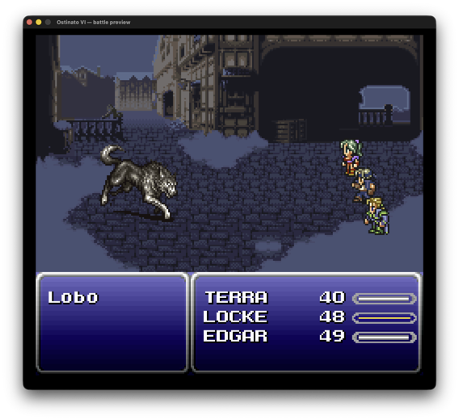
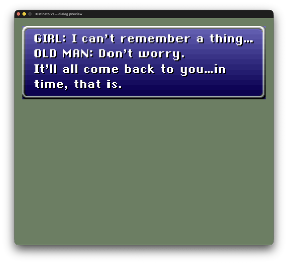

# Ostinato VI

A native C++ reimplementation of **Final Fantasy VI** (Super Famicom / SNES), built on the [Polyrhythm engine](https://github.com/RetroPlusPlus/Polyrhythm). The goal is behavioral fidelity — same observable behavior as the original given the same inputs and RNG state — running as ordinary native code on Windows, macOS, and Linux.

It is not an emulator, a recompilation or a decompilation. A recompilation translates the game's machine code; a decompilation rebuilds C that compiles back to the same machine code. Ostinato VI reads what each routine of the original does and writes it again as ordinary, readable C++ against a portable engine. The game you play is that C++ alone.

The port is then tested against the original game itself. The Polyrhythm engine can host the cartridge on its own SNES machine — calling the game's routines directly, playing it frame by frame, recording what it reads, writes and draws — so every part of the port can be held up against the real thing: the game's rules down to every byte of memory the original writes, what it draws and where, and its timing, from how many frames something takes to the input lag and the slowdown the player feels. Where the original has a bug, the port keeps it and says so.

**Status: early.** The game data, the cartridge route, the field dialog and the battle's rules are in place — the battle's clock and turns, every command, the damage, the statuses, the attacks' special effects, the espers, the monsters' AI and what a won battle gives, the last six checked against the cartridge's own code. The battle engine is not finished: its start, its loop and clock, the player's commands and whole battles from start to end have yet to be checked against the cartridge's battle program, and that work is under way. The game is not yet playable: the game binary installs your cartridge on first launch, then prints the engine version and exits, and what is built so far runs in tests and in the preview tools under `tools/previews/`.

## How it's checked

What the checks cover so far, as each part of the game is built:

- **Against the cartridge's own code.** In the test suite, the engine hosts the cartridge on its SNES machine and calls the original routine; the port's C++ is given the same battle, and every memory cell the original writes must match the port's answer — over cases picked from the original's edge cases and over seeded sweeps of random battles. The damage, the statuses, the special effects, what an esper teaches and gives at a level-up, the monsters' AI scripts and a battle's end with its rewards are all tested this way. The battle's start, its loop and clock, and the player's commands are not yet.
- **Against real play.** Fights played on the cartridge, on the engine's SNES machine, are recorded: every read and write the watched routines make, frame by frame — the damage, the statuses, the special effects, the AI scripts and the battle's end. The tests rebuild each recorded call for the port, and the port must come out the same. Seven fights are recorded and replayed in the test suite, the first fight in Narshe won and lost among them. No fight is yet compared whole, from its start to its end. The recorder is [`tools/damage-trace/`](tools/damage-trace/README.md).
- **Against the picture.** Where the battle preview puts things is measured from the console's own frames, recorded 1:1 from the cartridge running on the same machine ([`tools/frames/`](tools/frames/README.md)).
- **Every table, every entry.** Every data table the game compiles in is compared with the original entry by entry, for every entry and every field, not a sample.
- **The original's bugs, kept and written down.** When the original misbehaves, the port does the same, and [`docs/Bugs.md`](docs/Bugs.md) records it: what the player sees, where the original does it, where the port keeps it, and what to change to fix it — 31 so far, from Umaro's throw adding one to Mog's power to a failed Metamorph announcing an item the party never gets.
- **On every platform.** More than 3,300 tests; the C++ suite runs on Linux, macOS and Windows, x64 and ARM.

## Progress

- [x] **Game data** — every compiled-in mechanics table: characters, magic and espers, items and shops, monsters, formations and encounters, battle commands and formulas, attack animations, maps, NPCs and event triggers, and the world map
- [x] **Cartridge install** — your ROM identified and copied once, then read in place on every launch, for all three releases
- [x] **Game text** — the whole script and every name table, loaded and decoded
- [x] **Field dialog text** — typing, word wrap, choices, the page wipe and the map title, drawn in the game's own font, with a self-playing preview
- [x] **Field dialog window** — the box the text types into, drawn from the cartridge's own art: opening and closing, top or bottom placement, text-only messages, the map-title box
- [ ] **Battle engine** *(in progress)*
  - [x] **The battle's clock and turns** — the battle's start from its formation (pincers, back and side attacks), the ATB gauges at every battle speed, Slow, Haste and Stop, who acts when, running away, and the battle's end
  - [x] **Every command** — Fight and the desperation attacks, Item, Throw and Tools, Magic, Steal, Leap, Control, Sketch, Rage, Dance, Blitz, Bushido, Jump, Slot, GP Rain, Morph, Runic and the rest, with who each one can reach and whether it hits
  - [x] **Damage** — every damage and healing formula, each target's elements, row, defense and multipliers, the damage taken and shown, and spells bounced off Reflect, each checked against the cartridge
  - [x] **Statuses** — every status put on and taken off, the statuses a battle starts with, and the relics that act near death, each checked against the cartridge
  - [x] **Special effects** — what each attack does beyond its damage: Steal, Metamorph, Control, Sketch, instant kills and the rest, each checked against the cartridge; the links between battlers let go when they should end, and Morph's timer
  - [x] **Espers** — the spells an equipped esper teaches and its bonus at each level-up, each checked against the cartridge
  - [x] **Monster AI** — every monster's script: its turns, its counterattacks, who it aims at and what it tests, each checked against the cartridge
  - [x] **Rewards and experience** — how a battle ends and what a win gives: experience, levels and what they teach, spells from equipment, lores, dances, rages, drops and gold, every message in the cartridge's order, and the items obtained, each checked against the cartridge
  - [ ] **The battle whole** *(in progress)* — every part of the battle run against the cartridge's own battle program, and whole battles compared from their start to their end
    - [ ] **The battle's start** *(in progress)* — the cartridge's battle program is called whole, from a battle's start to its close, and the first fight's start is reached; to come: every formation, party, setting and battle type compared with the cartridge, memory cell by memory cell
    - [ ] **Battles with no player** — monsters on their scripts and party members acting by themselves, run to their end: the loop, the clock and its counters, counterattacks, and every way a battle ends
    - [ ] **The player's commands** — every command one action at a time, the commands taken in from the menu, and who a command is aimed at when it is chosen
    - [ ] **Battles with a player, and recorded fights** — whole battles with a player's commands, and real fights recorded from their start to their end and replayed
- [ ] **Battle presentation** *(in progress)*
  - [x] **The battle scene** — the background, the monsters and the party drawn where the battle stands them, the windows, the damage numerals and the death fade, from the cartridge's own art, with a self-playing preview
  - [ ] **Attack animations**
  - [ ] **Background effects and the battle transition**
  - [ ] **The battle menu**
- [ ] **Field engine** — maps, movement, NPCs, transitions, screen effects
- [ ] **Event scripts**
- [ ] **World map**
- [ ] **Menus**
- [ ] **Cutscenes**
- [ ] **Audio** — the original music and sound effects
- [ ] **Saving and loading**
- [ ] **Packaging and release**

## Screenshots

The preview tools under `tools/previews/`, each drawing from an installed cartridge.

**Battle** — `ostinato-preview-battle`: the background, the monster and the party, and the windows with the monster list and the party's names, HP and gauges.



**Field dialog** — `ostinato-preview-dialog`: a message typed into the dialog window.



## Version support

The port targets **all three releases** of the game: Final Fantasy VI 1.0 (Japan), Final Fantasy III 1.0 (US), and Final Fantasy III 1.1 (US). The ROM you supply determines the version and language — a Japanese ROM yields the Japanese localization (kanji/kana text and all), a US ROM the English one. One binary covers all three; version-specific behavior is carried explicitly rather than baked to a single release. Current development validates against FF3 1.1 (US), with the other two slotted in as verification ROMs become available.

## What this is not

This project is not an alternative to the official **Pixel Remaster** line, and it is not trying to compete with it. If you want a modernized Final Fantasy VI — updated visuals, rearranged audio, and quality-of-life conveniences — buy the Pixel Remaster and give Square Enix your money for their efforts.

For the same reason, this port will not be adding the convenience features common to modern re-releases and emulators: **no speed-up, no encounter disabling, no widescreen.** The point of the project is the original game, behaving as it did on the SNES, running as native code on modern platforms — fidelity is the feature, and gameplay-altering conveniences work against it.

## What ships and what doesn't

- **You supply your own ROM.** On first launch the app asks you to select your legitimately owned FF6 (J) or FF3 (US) ROM and copies it once into your own user files. Unlike extraction-based recompilations (Zelda64 recompiled, Ship of Harkinian), **nothing is extracted**: every launch reads the graphics, text and data it needs directly out of that copy, and leaves no extracted files behind. See [`docs/features/asset-acquisition.md`](docs/features/asset-acquisition.md).
- **No copyrighted content is committed to or distributed with this repository.** No ROMs, no graphics, no audio, no dialog text. `.gitignore` bans ROM extensions tree-wide, the installed copy included.

## Repository layout

| Path | What it is |
|---|---|
| `src/`, `include/ostinato/` | Port source and public headers |
| `tests/` | GoogleTest suite |
| `engine/` | [Polyrhythm](https://github.com/RetroPlusPlus/Polyrhythm) engine submodule |
| `original-src/` | Not part of this repository (ignored). Developers clone the [everything8215/ff6](https://github.com/everything8215/ff6) SNES disassembly (GPL-3.0) here as a read-only reference; nothing in the build or the distribution needs it |
| `docs/` | Project documentation (design context, feature docs, and the [developer guide](docs/engine/README.md) to the shipped surfaces) |
| `tools/` | Developer tools: the previews, the frame recorder and the data parsers ([index](tools/README.md)) |
| `scripts/` | Development tooling |
| `media/` | The screenshots on this page |

> **Note on the engine submodule:** it is public and initializes without credentials (`git submodule update --init --recursive`).
>
> **The disassembly, for development only:** the data parsers under `tools/asm_parser/` read the upstream disassembly from `original-src/`, which is not part of this repository. Clone it there at the commit the parsers are written against:
>
> ```sh
> git clone https://github.com/everything8215/ff6.git original-src
> git -C original-src checkout 1ea47b50dae4549362c7bef8fa887895fc378209
> ```
>
> Much of its data corpus is generated locally by its `make rip` step against a user-supplied ROM.

## Building

Requires CMake 3.28+, a C++20 compiler (GCC 13+ / Clang 16+ / AppleClang 15+ / MSVC 19.38+), and recursive submodules:

```sh
git clone --recursive git@github.com:etroimcasso/OstinatoVI.git
cd OstinatoVI
cmake -S . -B build
cmake --build build --parallel
ctest --test-dir build
```

The build defaults to a lean Release configuration (optimized, dead-stripped, symbol-stripped).

## License

This port's source is licensed under the **GNU Affero General Public License v3.0** (AGPL-3.0); see [LICENSE](LICENSE). Copyright © 2026 the OstinatoVI authors. The Polyrhythm engine (the `engine/` submodule) carries its own license, the **PolyForm Noncommercial License 1.0.0**: free for noncommercial use; see [engine/LICENSE](engine/LICENSE).

The upstream disassembly ([everything8215/ff6](https://github.com/everything8215/ff6)) is GPL-3.0 and is used only as a design/derivation reference — AGPL-3.0 remains compatible with it. Final Fantasy VI is the property of Square Enix; this project ships no Square Enix-copyrighted content and requires the user's own ROM.
