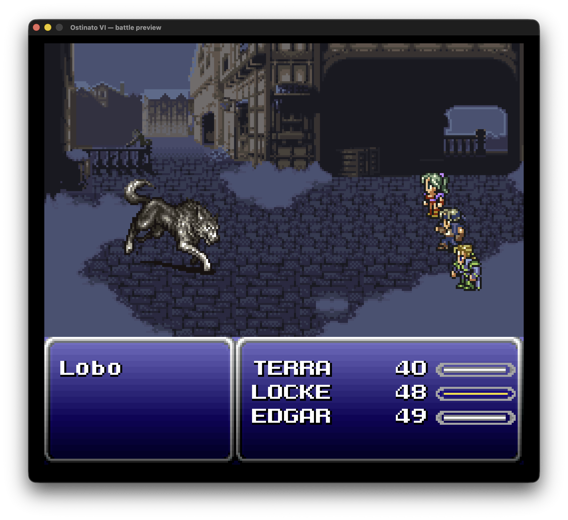
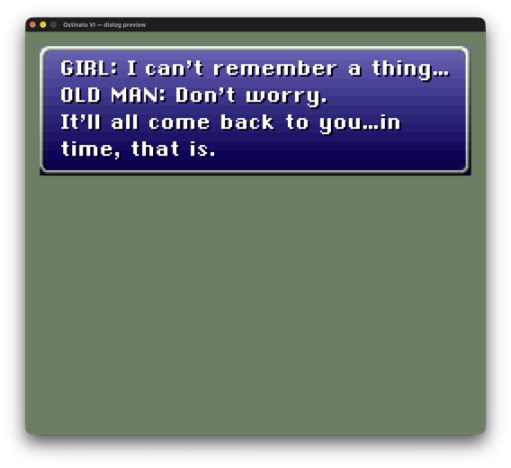

# Ostinato VI

A native C++ reimplementation of **Final Fantasy VI** (Super Famicom / SNES), built on the
[Polyrhythm engine](https://github.com/RetroPlusPlus/Polyrhythm). The goal is behavioral
fidelity — same observable behavior as the original given the same inputs and RNG state —
running as ordinary native code on Windows, macOS, and Linux. Not an emulator, and not a
mechanical ASM translation: idiomatic modern C++ against a portable engine layer.

**Status: early.** The data layer (every compiled-in mechanics table), the cartridge ingestion
route, and the field dialog text engine and its window are in place; the game is not yet playable.
The game binary installs your cartridge on first launch, then prints the engine version and exits;
the dialog engine and its window run in their own preview tool under `tools/previews/`.

## Progress

- [x] **Game data** — every compiled-in mechanics table: characters, magic and espers, items and
  shops, monsters, formations and encounters, battle commands and formulas, attack animations,
  maps, NPCs and event triggers, and the world map
- [x] **Cartridge install** — your ROM identified and copied once, then read in place on every
  launch, for all three releases
- [x] **Game text** — the whole script and every name table, loaded and decoded
- [x] **Field dialog text** — typing, word wrap, choices, the page wipe and the map title, drawn in
  the game's own font, with a self-playing preview
- [x] **Field dialog window** — the box the text types into, drawn from the cartridge's own art:
  opening and closing, top or bottom placement, text-only messages, the map-title box
- [ ] **Battle engine** *(in progress)*
- [ ] **Battle presentation** *(in progress)* — the background, the monsters and the party drawn where
  the battle stands them, from the cartridge's own art, with a self-playing preview
- [ ] **Field engine** — maps, movement, NPCs, transitions, screen effects
- [ ] **Event scripts**
- [ ] **World map**
- [ ] **Menus**
- [ ] **Cutscenes**
- [ ] **Audio** — the original music and sound effects
- [ ] **Saving and loading**
- [ ] **Packaging and release**

## Screenshots

The preview tools under `tools/previews/`, each drawing from an installed cartridge.

**Battle** — `ostinato-preview-battle`: the background, the monster and the party, and the windows
with the monster list and the party's names, HP and gauges.



**Field dialog** — `ostinato-preview-dialog`: a message typed into the dialog window.



## Version support

The port targets **all three releases** of the game: Final Fantasy VI 1.0 (Japan), Final
Fantasy III 1.0 (US), and Final Fantasy III 1.1 (US). The ROM you supply determines the
version and language — a Japanese ROM yields the Japanese localization (kanji/kana text and
all), a US ROM the English one. One binary covers all three; version-specific behavior is
carried explicitly rather than baked to a single release. Current development validates
against FF3 1.1 (US), with the other two slotted in as verification ROMs become available.

## What this is not

This project is not an alternative to the official **Pixel Remaster** line, and it is not
trying to compete with it. If you want a modernized Final Fantasy VI — updated visuals,
rearranged audio, and quality-of-life conveniences — buy the Pixel Remaster and give
Square Enix your money for their efforts.

For the same reason, this port will not be adding the convenience features common to
modern re-releases and emulators: **no speed-up, no encounter disabling, no widescreen.**
The point of the project is the original game, behaving as it did on the SNES, running as
native code on modern platforms — fidelity is the feature, and gameplay-altering
conveniences work against it.

## What ships and what doesn't

- **You supply your own ROM.** On first launch the app asks you to select your legitimately
  owned FF6 (J) or FF3 (US) ROM and copies it once into your own user files. Unlike
  extraction-based recompilations (Zelda64 recompiled, Ship of Harkinian), **nothing is
  extracted**: every launch reads the graphics, text and data it needs directly out of that
  copy, and leaves no extracted files behind. See
  [`docs/features/asset-acquisition.md`](docs/features/asset-acquisition.md).
- **No copyrighted content is committed to or distributed with this repository.** No ROMs, no
  graphics, no audio, no dialog text. `.gitignore` bans ROM extensions tree-wide, the installed
  copy included.

## Repository layout

| Path | What it is |
|---|---|
| `src/`, `include/ostinato/` | Port source and public headers |
| `tests/` | GoogleTest suite |
| `engine/` | [Polyrhythm](https://github.com/RetroPlusPlus/Polyrhythm) engine submodule |
| `original-src/` | Not part of this repository (ignored). Developers clone the [everything8215/ff6](https://github.com/everything8215/ff6) SNES disassembly (GPL-3.0) here as a read-only reference; nothing in the build or the distribution needs it |
| `docs/` | Project documentation (design context, feature docs, and the [developer guide](docs/engine/README.md) to the shipped surfaces) |
| `tools/` | Developer tools: the previews, the frame recorder and the data parsers ([index](tools/README.md)) |
| `scripts/` | Development tooling |
| `media/` | The screenshots on this page |

> **Note on the engine submodule:** it is public and initializes without credentials
> (`git submodule update --init --recursive`).
>
> **The disassembly, for development only:** the data parsers under `tools/asm_parser/` read the
> upstream disassembly from `original-src/`, which is not part of this repository. Clone it there
> at the commit the parsers are written against:
>
> ```sh
> git clone https://github.com/everything8215/ff6.git original-src
> git -C original-src checkout 1ea47b50dae4549362c7bef8fa887895fc378209
> ```
>
> Much of its data corpus is generated locally by its `make rip` step against a user-supplied ROM.

## Building

Requires CMake 3.28+, a C++20 compiler (GCC 13+ / Clang 16+ / AppleClang 15+ / MSVC 19.38+),
and recursive submodules:

```sh
git clone --recursive git@github.com:etroimcasso/OstinatoVI.git
cd OstinatoVI
cmake -S . -B build
cmake --build build --parallel
ctest --test-dir build
```

The build defaults to a lean Release configuration (optimized, dead-stripped, symbol-stripped).

## License

This port's source is licensed under the **GNU Affero General Public License v3.0** (AGPL-3.0);
see [LICENSE](LICENSE). Copyright © 2026 the OstinatoVI authors. The Polyrhythm engine (the
`engine/` submodule) carries its own license, the **PolyForm Noncommercial License 1.0.0**: free
for noncommercial use; see [engine/LICENSE](engine/LICENSE).

The upstream disassembly ([everything8215/ff6](https://github.com/everything8215/ff6)) is GPL-3.0
and is used only as a design/derivation reference — AGPL-3.0 remains compatible with it. Final
Fantasy VI is the property of Square Enix; this project ships no Square Enix-copyrighted content
and requires the user's own ROM.
